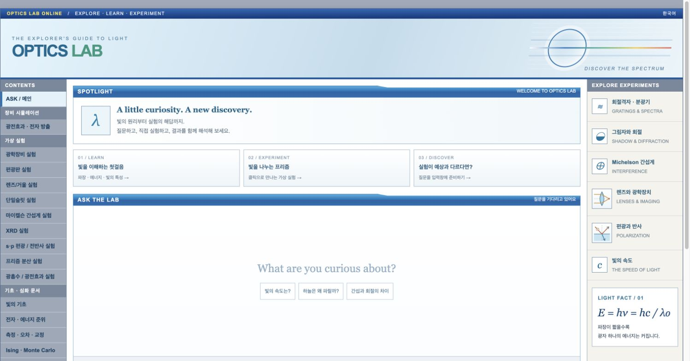
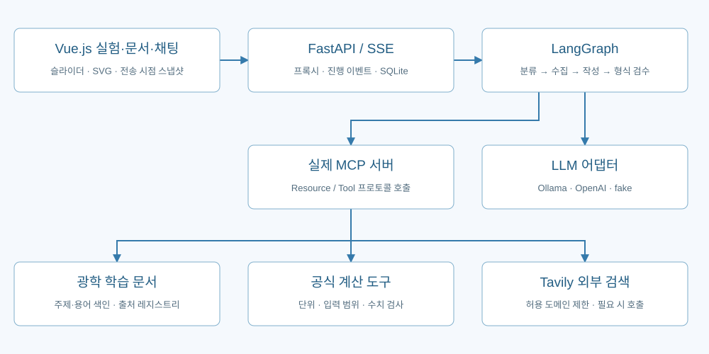
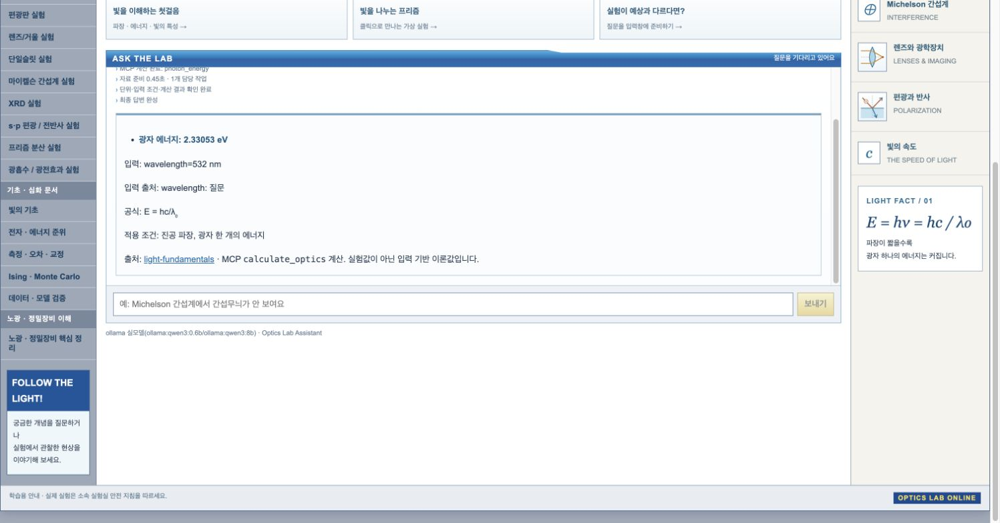
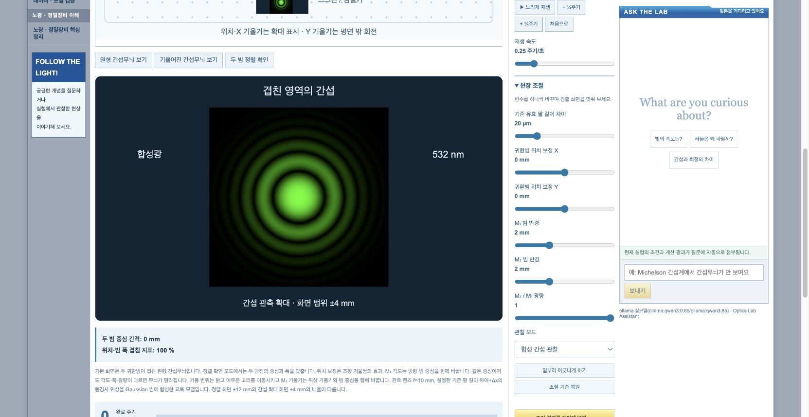
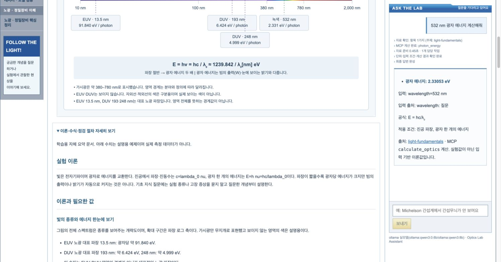
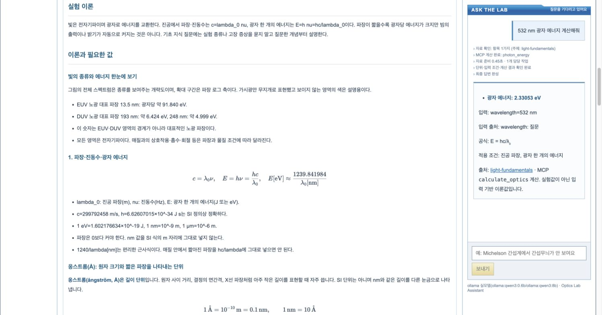
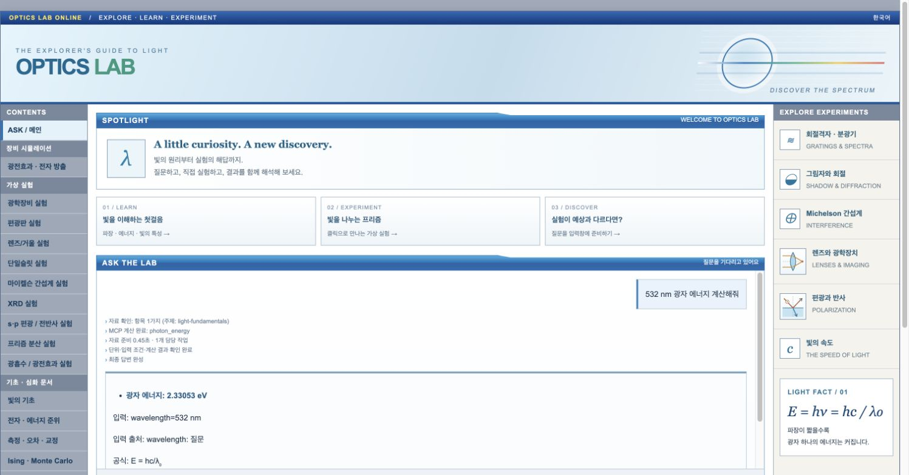
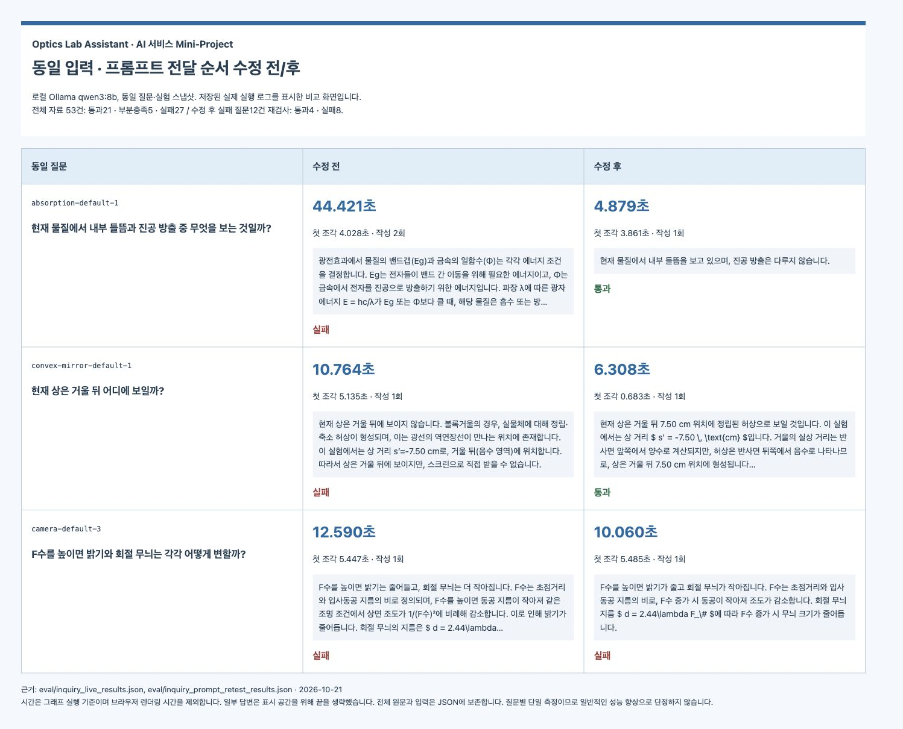

# Optics Lab Assistant

**실험을 조작하고, 현재 조건을 바탕으로 AI에게 질문하는 광학 학습 도우미입니다.**

- 편광·간섭·회절·XRD·프리즘·렌즈·거울·광흡수 가상 실험
- 카메라·망원경·현미경의 광경로와 계산 결과
- 접이식 이론·공식·확인 문제, 별도 학습 문서
- LangGraph 질문 처리, 실제 MCP 문서 조회·수치 계산
- 선택적 Tavily 외부 검색, Markdown·LaTeX, SSE 채팅

## 시작하기

프로젝트 루트에서 `bash sh/setup_venv.sh`로 환경을 준비합니다. `.env`가 없다면 `.env.example`을 복사하고 사용할 API 키를 입력합니다.

터미널 1에서 `bash sh/run_agent_openai.sh` 또는 `bash sh/run_agent_ollma.sh`, 터미널 2에서 `bash sh/run_frontend.sh`를 실행한 뒤 **http://localhost:8600**에 접속합니다. OpenAI는 API 사용료가 발생하며, Ollama는 먼저 로컬 모델 준비가 필요합니다.

[전체 아키텍처·실행·검증](doc/README.md) · [OpenAI 가이드](doc/manual_openai.md) · [Ollama 가이드](doc/manual_ollma.md) · [회귀 테스트](doc/regression_test_queries.md)

## 문서 안내

- [상세 실행·아키텍처](doc/README.md)
- [탐구 질문 공식 연결](doc/inquiry-formula-mapping.md) · [현장 조절·검출 화면](doc/practical-adjustments.md)
- [출처 점검](doc/source-audit.md) · [개인정보·비밀정보 점검](doc/privacy-audit.md)

**선택 과제: 과제 2 · 새로운 도메인의 AI 서비스 구현**
**주제: 대화형 광학 실험·장비 이상 점검 도우미 「Optics Lab Assistant」**
작성일: 2026년 10월 21일 · 공식 연결 검증 갱신: 2026년 10월 22일

> 가상 실험을 직접 조절하고, 그 순간의 실험 조건을 공유한 AI에게 이론·계산·관찰 결과를 질문하는 광학 학습 서비스이다.

## 1. 진행 사항 소개

### 1.1. 과제 선정 배경과 목표

처음에는 반도체 장비의 이상치를 확인하고 대응 매뉴얼을 안내하는 서비스를 구상했다. 그러나 실제 장비 데이터와 대응 절차는 접근이 제한되거나 기밀에 해당할 수 있어, 공개된 원리로 구현할 수 있는 **광학 실험·장비 학습**으로 주제를 변경했다.

광학 질문도 사용자가 실험값을 매번 만들어 입력하고 장치 상태를 다시 설명해야 한다면 번거롭다. 이를 줄이기 위해 **가상 실험 → 조건 변경 → 관찰 → 질문**을 한 화면에서 이어가도록 구성했다. 주요 대상은 실험 수업 중 막힌 학생과 이론을 복습하는 사람이다.

핵심 목표는 다음과 같다.

- **조건 공유:** 질문을 보내는 순간의 실험 종류·설정·계산 결과를 자동 전달한다.
- **학습 연결:** 현재 값의 의미를 이론·공식·참고 자료와 연결한다.
- **재현 가능한 계산:** 지원 수식의 결과는 LLM의 암산 대신 단위 검사를 거친 도구로 구한다.
- **실험 조작:** 광경로뿐 아니라 빔 정렬·스크린 위치·편광축 오차 같은 조절을 경험하도록 한다.

실제 센서의 이상치를 감지하거나 물리 장비를 제어하는 서비스는 아니다. 공개 이론을 단순화한 학습 모델이다.

### 1.2. 주요 Task

| Task | 입력과 처리 | 출력 |
| --- | --- | --- |
| 질문 분류·계획 | 사용자 질문·현재 실험 정보를 바탕으로 문서·계산·검색 필요 여부 결정 | 필요한 작업 목록과 처리 경로 |
| 실험 조건 공유 | 화면의 전송 시점 설정과 결과를 문자열·계산 입력으로 구성 | 현재 실험 스냅샷 |
| 학습 문서 조회 | 주제·용어 색인으로 문서 ID를 선택하고 MCP Resource 조회 | 관련 문서와 출처 |
| 공식 계산 | 지원 계산을 선택해 MCP Tool 호출, 단위·유효 범위 검사 | 수치·공식·입력 출처 또는 계산 불가 사유 |
| 외부 자료 검색 | 필요한 질문에 Tavily 호출, 허용 도메인과 반환 URL 검사 | 참고 URL·본문 발췌·검색 상태 |
| 답변 작성·형식 검사 | 질문·조건·자료를 LLM에 전달하고 길이·서식·생성 중단 여부 확인 | 답변과 진행 이벤트 |
| 가상 실험·탐구 질문 | 슬라이더·드래그·방향키로 조건 변경, 탐구 질문을 입력창에 준비 | 검출 화면 변화와 후속 질문 |

### 1.3. 구현 범위

편광판, 렌즈·거울 4종, 단일·이중슬릿, 마이켈슨 간섭계, XRD, s/p 편광·전반사, 프리즘, 광흡수·광전효과와 카메라·망원경·현미경을 구현했다. UI 검사는 장비 하위 종류를 포함한 **14개 선택 화면**을 대상으로 했다. 같은 메뉴에서 전환되는 하위 종류가 있으므로 메뉴 버튼 개수와는 다르다.

*그림 1. 실제 브라우저에서 실행한 메인 화면. 실험 메뉴·문서 메뉴·채팅을 한 서비스에서 이용한다.*

## 2. 사용한 기술 요소와 구현 내용

### 2.1. 전체 아키텍처

*그림 2. 브라우저 실험 계산과 AI 질의 처리를 구분한 구성. 슬라이더 조작만으로 LLM을 호출하지 않는다.*

일반 실행은 화면 서버 `8600`과 백엔드 `8100`을 사용한다. 브라우저는 실험을 즉시 계산하고, 사용자가 질문할 때만 현재 조건을 백엔드에 전송한다. 백엔드는 LangGraph에서 필요한 작업을 선택하고 실제 MCP 서버를 통해 문서·계산·검색을 호출한다.

### 2.2. 적용한 기술 요소

| 기술 | 적용 내용 | 구현 근거 |
| --- | --- | --- |
| LangGraph·Multi-Agent 관점의 역할 분리 | 분류·계획·문서·검색·계산·작성·형식 검사 역할을 노드와 작업으로 분리 | `agent/graph.py` |
| 조건 분기·병렬 수집 | 계산만 필요한 경우 문서·검색·LLM을 생략하고, 독립적인 문서 조회와 검색은 `asyncio.gather`로 수집 | `agent/graph.py` |
| MCP | 학습 문서는 Resource, 공식 계산·웹 검색은 Tool로 실제 프로토콜 호출 | `mcp_server.py`, `agent/mcp_client.py` |
| 문서 검색 기반 생성 | 주제·동의어 색인으로 자료를 선택해 답변 근거로 전달 | `agent/optics.py`, `data/optics_terms.json`, `data/runbooks/` |
| 의존성 주입 | 모델·MCP 클라이언트·세션 저장소를 구성 객체로 주입해 테스트에서 교체 | `agent/deps.py`의 `SupervisorDeps` |
| 모델 어댑터 | Ollama·OpenAI·fake를 같은 작성 인터페이스로 사용 | `agent/ollama_llm.py`, `agent/openai_llm.py`, `agent/fake_llm.py` |
| LangSmith | `@traceable`로 그래프·모델·도구 호출을 계측할 수 있도록 구성 | 서버 환경 설정과 각 모듈의 계측 코드 |
| FastAPI·SSE·SQLite | REST/SSE 제공, 진행 상태·답변 조각 전송, 대화 이력 저장 | `server.py`, `web_demo_server.py`, `agent/session_store.py` |
| Vue.js·SVG·KaTeX | 조건 조절, 장치·검출 화면, 접이식 문서·공식, LaTeX 렌더링 | `web_chat.html`, `optics_lab.js` |
| 모듈화·테스트 | 화면·수치 도구·검색·문서·세션을 분리하고 Python·JavaScript 검사 작성 | `agent/`, `tests/`, `eval/` |

**적용 범위의 구분:** 역할을 분리한 에이전트 처리 흐름을 구현했지만, 모든 노드가 독립적인 LLM 에이전트인 것은 아니다. 분류·문서 매핑·공식 계산·형식 검사는 주로 규칙과 코드가 담당하고, 설명 작성에 LLM을 사용한다. RAG도 임베딩·벡터 DB 검색이 아니라 **문서·용어 색인으로 검색한 자료를 생성에 연결하는 형태**이다. 형식 검사는 물리 사실 검증기가 아니다.

LangSmith는 계측을 적용한 기술 요소로 기재했다. 아래 수치 비교는 LangSmith 대시보드에서 추출한 값이 아니라 **로컬 평가 코드가 직접 기록한 시간**이다.

### 2.3. 기존 기능의 개선과 추가 구현

기존 CPU·메모리·디스크 장애 대응 중심의 구성을 광학 문서·주제 매핑·계산 도구로 변경하고, 광학과 관계없는 레거시 자료를 정리했다.

| 구분 | 개선·추가 내용 |
| --- | --- |
| 도메인 | 광학 실험별 문서·기초 개념·용어·참고 출처로 재구성 |
| 조건 전달 | 질문 전송 시 스냅샷을 복사해 이후 슬라이더 변경과 분리 |
| 계산 정확성 | 질문에서 명시한 입력과 현재 설정을 구분하고, 목표 역산을 현재값 계산으로 대체하지 않도록 수정 |
| 응답 흐름 | 불필요한 LLM 호출을 줄이고 SSE로 진행·답변을 전달, 중지 후 재질문 가능 |
| 프롬프트 | 참고 자료·실험 조건·실제 질문을 구분하고 질문을 마지막에 배치 |
| 학습 UI | 문서 조회를 AI 호출과 분리하고, 실험·조절 장치·채팅을 함께 표시 |
| 이론·탐구 | 접이식 공식·유의사항과 조작→관찰→역산을 유도하는 탐구 질문 추가 |
| 출처 | 문서 18개의 자료 위치·접근 범위를 기록하고, 문헌 입력값·대표값·실측값을 구분 |
| 현장 조절 | 빔 정렬, 스크린 초점, 시료 미동, 검출기 영점, 편광축 오차 등을 검출 화면에 연결 |

출처는 기관·교재·학술 자료의 해당 절·표·초록을 연결했다. 허용 도메인에 있다는 사실만으로 검색 내용이 검증된 것은 아니며, 유료 본문이나 원문 전체를 수집한 것처럼 표현하지 않았다.

### 2.4. 구현 기능 화면 캡처

#### A. 실제 MCP 계산과 출처 표시

*그림 3. `532 nm 광자 에너지 계산해줘`를 입력한 실제 실행 결과. MCP 계산 경로에서 약 2.33053 eV, 입력 단위·공식·자료 링크를 표시한다. 이 화면은 수치 도구 경로이며 LLM이 계산한 결과로 제시하지 않는다.*

#### B. 마이켈슨 빔 정렬과 간섭무늬 관찰

*그림 4. 두 빔을 정렬한 상태의 원형 간섭무늬. 파장 532 nm, 초기 팔 길이 차이 · 편도 20 µm에서 관찰한 합성 간섭 화면이다.*

*그림 5. 거울 기울기에 따른 띠 간섭무늬. 빔 중심을 유지하면서 기울기를 바꾸면 선형 위상 차이에 따라 밝고 어두운 띠가 나타난다.*

이외에도 렌즈·카메라는 스크린·센서 위치, 현미경은 시료 미동, XRD는 영점·시료 높이, 편광은 축 오차를 직접 바꾸게 했다. [조절 항목과 모델의 가정](doc/practical-adjustments.md)을 별도로 정리했다.

#### C. AI 호출 없이 읽는 이론 문서와 수식

*그림 6. 문서 페이지는 별도 AI 질문 없이 조회하고, 옆 채팅 내용은 유지한다.*

*그림 7. 접이식 이론을 펼쳐 광자 에너지·파장 관계를 KaTeX로 표시한 화면.*

### 2.5. 최종 실행 화면과 검증 범위

*그림 8. 보고서 작성 시 실제 로컬 브라우저에서 확인한 최종 실행 화면. 메인에서 질문하고 MCP 계산 결과를 확인했다. 그림 1·3–8은 실제 애플리케이션 캡처이다.*

검증은 서로 다른 범위를 구분했다.

| 검증 종류 | 기록한 결과 | 해석 |
| --- | --- | --- |
| Python 자동 검사 (초기 보고 시점) | 30개 통과 | 검색 URL 경계, 입력 단위·범위, 문서 연결, 그래프·응답 정책 등 기능 검사 |
| 기존 공식 계산 평가 | 11/11 통과 | fake LLM을 사용했으나 MCP·계산 도구는 실제 실행. 자연어 품질 평가와 구분 |
| JavaScript·UI 검사 | 장비·실험과 14종 현장 조절 검사 통과 | 계산·범위 끝값·화면 변화·채팅 첨부·키보드 빔 정렬 확인 |
| 실제 Qwen 탐구 질문 | 53건: 통과 21, 부분 충족 5, 실패 27 | 원답을 기준식·실험 조건과 수동 대조. 형식 검사 통과와 구분 |
| 프롬프트 수정 후 재검사 | 실패 질문 12건 중 통과 4, 실패 8 | 나머지 41건이 수정 후 재검증됐다고 주장하지 않음 |

자동 검사와 수치 도구가 통과해도 자연어 답변의 사실성까지 보장되지는 않았다. 전반사 조건, 상의 위치, F수와 회절 크기, 미지정 결정면 생성 등의 오답이 남아 있다. **현재 구현을 검증된 광학 전문가나 실제 장비 정비 도구로 평가하지 않는다.** 현장 조절 기능을 추가한 뒤 AI 자연어 답변 전체 53건을 다시 검사한 것은 아니며, 위 실모델 평가는 저장된 당시 입력에 대한 결과이다.

### 2.6. 추가 개선 — 탐구 질문과 공식 연결 (10월 22일)

기존 프롬프트 정리만으로 초점거리 역산·허상 방향·회절 크기 오답이 남아, **14개 화면의 탐구 질문 38개**에 계산 목적을 연결했다. 질문 전송 시점의 설정과 계약 ID를 전달하고 MCP 계산 도구가 공식·역산·범위를 검사한다. 이 경로는 계산 결과와 코드로 작성한 설명을 표시하며 LLM을 다시 호출하지 않는다. 문장을 편집한 질문이나 일반 자유 질문은 기존 경로로 처리한다.

- 물체 거리 30cm에서 같은 크기 실상의 목표 초점거리 15cm, 물체 거리 40cm에서는 20cm로 재계산한다.
- 오목렌즈 허상의 물체 쪽 위치, F수 증가 시 회절 무늬 확대, 전반사 불가 조건 등을 별도 기준으로 검사한다.
- 새 UI에서 캡처한 기본·설정 변경 메시지 **53건 모두 실제 MCP 계산 경로 완료**, Python 테스트 **41개 통과**. 연결 성공을 일반 AI 정답률 100%로 해석하지 않는다.
- 기존 실모델 53건 평가와 입력 구조·처리 방식이 달라, 동일 조건의 모델 정확도 전후 비교로 제시하지 않는다. 기존 캡처는 당시 실행 화면이며 새 계산 경로의 캡처가 아니다.

[실험별 공식·가정·단위](doc/inquiry-formula-mapping.md) · [실제 계산 결과](eval/inquiry_contract_results.json) · [5분 발표 목차](doc/presentation-outline.md)

## 3. 선택 사항 — 동일 입력 개선 전/후 비교

### 3.1. 비교 조건

저장된 1차 전체 실행 기록과 프롬프트 전달 순서 수정 후 기록을 비교했다. 아래 세 사례는 **질문뿐 아니라 실험 스냅샷을 포함한 전체 입력 문자열이 동일함**을 확인했다. 모델은 로컬 Ollama `qwen3:8b`이다.

시간은 그래프 실행 시작부터 첫 답변 조각·최종 답변까지 측정했다. 브라우저 렌더링 시간은 포함하지 않는다. 각 입력은 실행 단계별 단일 측정이므로 모델 캐시·시스템 부하를 통제한 반복 실험이나 일반적인 성능 향상으로 해석하지 않는다.

### 3.2. 정량·내용 비교

| 동일 질문 | 완료 시간 전→후 | 첫 답변 조각 전→후 | 작성 횟수 전→후 | 내용 결과 |
| --- | --- | --- | --- | --- |
| 현재 물질에서 내부 들뜸과 진공 방출 중 무엇을 보는 것일까? | 44.421→4.879초 | 4.028→3.861초 | 2→1회 | 무관한 개론 반복→현재 내부 들뜸 모델임을 직접 답함 |
| 현재 상은 거울 뒤 어디에 보일까? | 10.764→6.308초 | 5.135→0.683초 | 1→1회 | 앞뒤가 모순된 설명→거울 뒤 7.50 cm 허상으로 설명 |
| F수를 높이면 밝기와 회절 무늬는 각각 어떻게 변할까? | 12.590→10.060초 | 5.447→5.485초 | 1→1회 | 전·후 모두 회절 크기 방향 오답. 지연 감소가 내용 개선은 아님 |

작성 횟수는 LLM 작성·재작성 수이며 도구 호출의 네트워크 재시도(Retry)와 다르다. 비용·검색 정확도는 이 비교에서 측정하지 않았다. 로컬 모델의 실행 시간이 줄었다고 유료 API 비용 절감이나 전체 시스템 속도 향상을 주장하지 않는다.

*그림 9. 실제 저장된 원답·시간을 읽기 쉬운 표로 표시해 캡처한 비교 화면. 과거 애플리케이션 화면을 재현한 것이 아니며, 긴 답변 일부는 표시 공간 때문에 생략했다. 개선된 사례와 실패가 남은 사례를 함께 제시했다.*

근거 자료: [1차 원답·시간](eval/inquiry_live_results.json), [재검사 원답·시간](eval/inquiry_prompt_retest_results.json), [전체 판정 보고서](doc/inquiry-validation.md), [비교 로그 화면](doc/report-comparison.html).

## 4. 느낀 점 및 향후 개선 사항

### 4.1. 느낀 점

이번 과제를 통해 AI 서비스의 차별점은 모델에 질문을 전달하는 것뿐 아니라, **어떤 조건과 도구를 연결해 사용자의 작업 흐름을 줄이는지**에 있다고 느꼈다. 광학 실험을 조절하며 바로 질문할 수 있게 하면서, 사용자가 값을 매번 설명해야 하는 번거로움을 줄이고자 했다.

또한 공개 문서를 연결했다고 답변이 자동으로 정확해지는 것은 아니었다. 실제 모델은 공식과 다른 결론을 말하거나, 다른 물질의 예시값을 현재 값처럼 사용할 수 있었다. 형식 검사가 통과한 답변도 원답을 직접 확인해야 했다. 따라서 **단위·수치는 도구로 확인하고, 자연어 설명은 별도로 평가하는 과정**이 중요하다는 점을 배웠다.

실험 화면 역시 조절 막대가 있다는 것만으로 충분하지 않았다. 조절값이 광선·초점·검출값에 실제로 연결되어야 관찰과 질문이 의미를 갖는다. 두 빔의 위치·각도·폭을 구분하는 정렬 조절을 추가한 과정은 이러한 점을 확인하는 계기가 됐다.

### 4.2. 향후 개선 사항

1. **답변 내용 검증 강화:** 물리량의 증감 방향, 상의 방향, 미설정 값의 생성 여부를 검증할 구조화 근거와 의미 평가를 추가한다. 형식 검사만으로 사실 검증을 대신하지 않는다.
2. **자유 질문 계산 확대:** 등록된 탐구 질문의 공식 연결을 바탕으로 자유 질문도 목표 물리량·고정 조건으로 구조화한다. 특정 질문의 고정 수치 답안을 저장하는 방식은 피한다.
3. **평가 체계 개선:** 같은 입력·설정으로 반복 측정하고, 첫 토큰·완료 시간·재작성·내용 정확도를 함께 기록한다. 기능 수정 후 전체 회귀 평가를 다시 수행한다.
4. **검색 품질 개선:** 필요 시 임베딩 검색·재순위화를 도입하고, 검색된 문단과 실제 주장을 연결해 출처 적합성을 평가한다.
5. **실험 모델 보완:** 빔의 편광·결맞음, 장치 구경·수차·검출기 응답 등을 단계적으로 확장하고, 사용한 근사와 실제 데이터의 차이를 명확히 표시한다.
6. **현장 조절 학습 강화:** 사용자가 원인을 모르는 상태에서 여러 변수를 하나씩 점검하는 시나리오와 조정 이력 비교를 제공한다.

## 제출 전 확인

- [x] 공개 README에는 작성자의 이름·교육생 번호를 생략
- [x] 선택 과제·주제·주요 Task 소개
- [x] 적용 기술과 실제 구현 범위 설명
- [x] 기존 기능 개선 및 추가 기능 설명
- [x] 구현 기능의 실제 화면 캡처 포함
- [x] 최종 실행 화면 캡처 포함
- [x] 선택 사항: 동일 입력의 전/후 수치·원답 및 비교 화면 캡처 포함
- [x] 느낀 점과 향후 개선 사항 작성
- [x] 실모델 실패와 측정·검증 범위 공개

화면 캡처는 `doc/report_images/`에 저장했다. 제출용 문서에서 번호·성함이 요구된다면 공개 저장소와 분리한 제출본에 기재한다.
