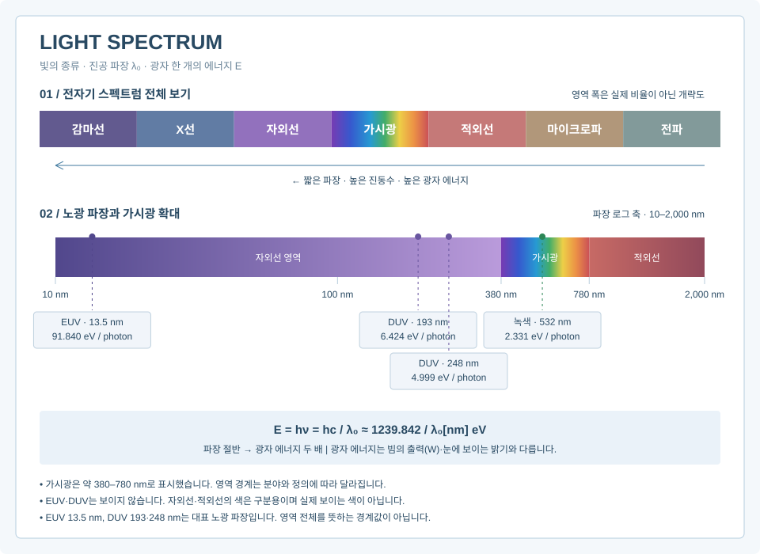
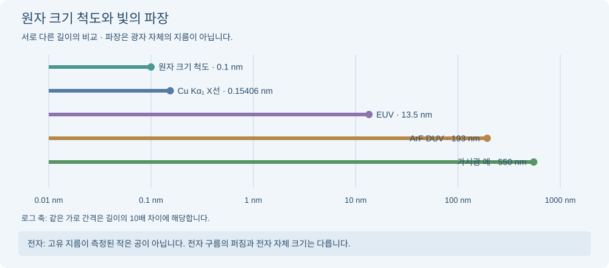

# 빛의 기초 지식

> **광학 실험 학습 노트** · 핵심을 먼저 보고, 필요한 내용만 펼쳐보세요.

- **파장 ↓ → 광자 에너지 ↑.** E = hc/λ₀입니다.
- **빛의 종류:** 전파부터 감마선까지 모두 전자기파입니다.
- **주의:** 광자 에너지와 출력·밝기는 다릅니다.
- **옹스트롬(Å):** 1 Å = 0.1 nm, 원자 간 거리·X선 파장에 자주 씁니다.

<strong>이론·수식·점검 절차 자세히 보기</strong>

학습용 자체 요약 문서. 아래 수치는 설명용 예제이며 실제 측정 데이터가 아니다.

## 실험 이론
빛은 전자기파이며 광자로 에너지를 교환한다. 진공에서 파장·진동수는 c=lambda_0 nu, 광자 한 개의 에너지는 E=h nu=hc/lambda_0이다. 파장이 짧을수록 광자당 에너지가 크지만 빔의 출력이나 밝기가 자동으로 커지는 것은 아니다. 기초 지식 질문에는 실험 종류나 고장 증상을 묻지 말고 질문한 개념부터 설명한다.

## 이론과 필요한 값

### 빛의 종류와 에너지 한눈에 보기

그림의 전체 스펙트럼은 종류를 보여주는 개략도이며, 확대 구간은 파장 로그 축이다. 가시광만 무지개로 표현했고 보이지 않는 영역의 색은 설명용이다.
- EUV 노광 대표 파장 13.5 nm: 광자당 약 91.840 eV.
- DUV 노광 대표 파장 193 nm: 약 6.424 eV, 248 nm: 약 4.999 eV.
- 이 숫자는 EUV·DUV 영역의 경계가 아니라 대표적인 노광 파장이다.
- 모든 영역은 전자기파이다. 매질과의 상호작용·흡수·회절 등은 파장과 물질 조건에 따라 달라진다.

### 1. 파장·진동수·광자 에너지
\[
c=\lambda_0\nu,\quad E=h\nu=\frac{hc}{\lambda_0},\quad
E[\mathrm{eV}]\approx\frac{1239.841984}{\lambda_0[\mathrm{nm}]}
\]
- lambda_0: 진공 파장(m), nu: 진동수(Hz), E: 광자 한 개의 에너지(J 또는 eV).
- c=299792458 m/s, h=6.62607015×10^-34 J s는 SI 정의상 정확하다.
- 1 eV=1.602176634×10^-19 J, 1 nm=10^-9 m, 1 µm=10^-6 m.
- 파장은 0보다 커야 한다. nm 값을 SI 식의 m 자리에 그대로 넣지 않는다.
- 1240/lambda[nm]는 편리한 근사식이다. 매질 안에서 짧아진 파장을 hc/lambda에 그대로 넣으면 안 된다.

### 옹스트롬(Å): 원자 크기와 짧은 파장을 나타내는 단위

**옹스트롬(ångström, Å)은 길이 단위**입니다. 원자 사이 거리, 결정의 면간격, X선 파장처럼 아주 작은 길이를 표현할 때 자주 씁니다. SI 단위는 아니며 nm와 같은 길이를 다른 눈금으로 나타냅니다.

\[
1\,\text{Å}=10^{-10}\,\mathrm{m}=0.1\,\mathrm{nm},\qquad
1\,\mathrm{nm}=10\,\text{Å}
\]

**Å → nm는 10으로 나누고, nm → Å는 10을 곱합니다.**

| 길이·파장 예시 | 옹스트롬 | 나노미터 |
|---|---:|---:|
| 가상의 결정 면간격 | 3 Å | 0.3 nm |
| Cu Kα₁ X선 대표 파장(근사) | 1.5406 Å | 0.15406 nm |
| EUV 노광 대표 파장 | 135 Å | 13.5 nm |
| ArF DUV 노광 대표 파장 | 1930 Å | 193 nm |
| 녹색 빛 예시 | 5320 Å | 532 nm |

**계산할 때 단위를 맞추세요.** XRD의 브래그 식 \(2d\sin\theta=n\lambda\)에서는 d와 λ를 모두 Å 또는 모두 nm로 넣어야 합니다. 예를 들어 d=3 Å, λ=1.5406 Å이면 1차 반사의 θ≈14.88°, 측정 축의 2θ≈29.76°입니다.

광자 에너지도 파장을 Å로 입력하려면 계수가 달라집니다.

\[
E[\mathrm{eV}]\approx\frac{12398.41984}{\lambda_0[\text{Å}]}
\]

예: 135 Å의 광자는 약 91.84 eV입니다. **1239.84는 nm용, 12398.42는 Å용**입니다. Å는 길이 단위이고, 기호 A를 쓰는 전류 단위 암페어와 다릅니다.

### 원자·전자와 빛을 비교하면?

**비교하는 것은 ‘원자의 공간적 크기’와 ‘빛의 파장’입니다.** 파장은 파동이 한 주기 반복되는 길이이며, 광자라는 작은 공의 지름이 아닙니다.

| 대상 | 대표 길이 | 0.1 nm 원자 척도와 비교 |
|---|---:|---:|
| 원자 크기의 대략적 척도 | 0.1 nm = 1 Å | 기준 1 |
| 수소 원자의 보어 반지름 a₀ | 약 0.0529 nm = 0.529 Å | 약 0.529배 (반지름 척도) |
| Cu Kα₁ X선 파장 | 0.15406 nm = 1.5406 Å | 약 1.54배 |
| EUV 노광 파장 | 13.5 nm = 135 Å | 135배 |
| ArF DUV 파장 | 193 nm = 1930 Å | 1930배 |
| 녹색 빛의 파장 예 | 550 nm = 5500 Å | 5500배 |

원자는 딱딱한 경계가 있는 구가 아닙니다. 크기는 원소·결합 상태·반지름 정의에 따라 달라집니다. 표의 **0.1 nm는 크기 감각을 위한 기준**이며 모든 원자의 지름이라는 뜻은 아닙니다. 보어 반지름도 전자의 크기가 아니라 수소 원자 전자 분포의 대표 길이 척도입니다.

**전자는 얼마나 클까?** 표준모형에서 전자는 내부 구조 없는 점입자로 다룹니다. 측정된 고유 지름을 원자처럼 표에 적을 수는 없습니다. 원자 속 전자 구름은 전자를 발견할 확률의 공간적 분포이며, 전자 자체가 그 크기의 공이라는 뜻이 아닙니다. ‘고전 전자 반지름’이나 ‘콤프턴 파장’도 전자의 실측 지름이 아닙니다.

**왜 XRD에 X선을 쓸까?** X선 파장이 결정의 원자 간 거리·면간격과 비슷한 척도여서 회절로 구조를 조사하기 좋습니다. 반면 가시광으로 원자를 보통의 원거리 광학현미경처럼 직접 분해하기는 어렵습니다. 실제 분해능은 파장만이 아니라 NA·관찰 방식에도 달려 있습니다. EUV 파장 13.5 nm를 원자 하나의 크기나 인쇄 선폭과 동일시하지 않습니다.

참고: [NIST · 보어 반지름](https://physics.nist.gov/cuu/Constants/Table/allascii.txt), [CERN · 전자의 점입자 설명](https://home.web.cern.ch/science/physics/standard-model/).

### 2. 파장별 에너지: 가상 계산표
| 진공 파장 | 대표 영역·예 | 광자 에너지(eV, 근삿값) |
|---|---|---|
| 1550 nm | 적외선 | 0.800 |
| 1064 nm | 적외선 | 1.165 |
| 700 nm | 붉은색 부근 | 1.771 |
| 632.8 nm | 붉은색 레이저 예 | 1.959 |
| 532 nm | 녹색 레이저 예 | 2.331 |
| 450 nm | 청색 부근 | 2.755 |
| 365 nm | 자외선 | 3.397 |
| 248 nm | 자외선 | 4.999 |
| 193 nm | 자외선 | 6.424 |
| 13.5 nm | 극자외선 | 91.840 |
이 값들은 파장으로 계산한 광자 에너지다. 특정 물질의 흡수·손상·공정 결과를 이 표만으로 확정하지 않는다.

### 3. 빛의 종류: 전자기 스펙트럼
긴 파장·낮은 진동수에서 짧은 파장·높은 진동수 순서:
전파 → 마이크로파 → 적외선 → 가시광선 → 자외선 → X선 → 감마선.
마이크로파는 전파의 하위 범주로 분류하기도 한다. 경계는 분야별 관례이며 엄밀한 단일 경계가 있는 것은 아니다. X선과 감마선은 에너지 영역이 겹칠 수 있고 발생 기원으로 구분하기도 한다.
가시광은 대략 380~780 nm 정도로 소개할 수 있으나 관찰자·밝기·정의에 따라 달라진다. 보라에서 빨강으로 갈수록 대체로 파장이 길다. 백색광은 여러 파장 성분의 혼합이며 단일 파장으로 지정하지 않는다.

### 4. 빛의 기본 특성
- 반사: 경계에서 되돌아감. 반사각=입사각이며 법선 기준이다.
- 굴절: 매질 경계에서 방향이 변함. n1 sin(theta1)=n2 sin(theta2).
- 회절: 개구·장애물 뒤에서 파동이 퍼지고 세기 분포를 형성함.
- 간섭: 파동의 중첩으로 세기가 위상차에 따라 달라짐.
- 편광: 전기장의 진동 상태. 진공의 진행 평면파는 횡파다.
- 분산: 굴절률이 파장에 의존함. 서로 다른 파장의 속도·굴절각이 달라질 수 있음.
- 흡수: 빛의 에너지가 물질로 전달됨. 단순 균일 매질에서 I(z)=I(0) exp(-alpha z).
- 산란: 입자·불균일성 등에 의해 진행 방향이 바뀜. 모든 산란이 같은 파장 의존성을 갖지는 않음.
- 파동·입자 이중성: 간섭·회절은 파동 모델, 광전 검출의 에너지 교환은 광자 모델이 유용함.

### 5. 매질에서의 빛
위상굴절률 n에 대해 v_phase=c/n, lambda_medium=lambda_0/n이다. 정지한 선형 경계에서 굴절될 때 진동수는 유지된다. 따라서 파장이 짧아져도 주파수가 그대로라면 광자 에너지가 증가했다고 해석하지 않는다.
분산 매질의 펄스·변조 전파는 군속도 v_g=d omega/d k와 구분한다.

### 6. 에너지·출력·세기·밝기의 구분
- 광자 에너지 E: 한 광자당 J 또는 eV.
- 광출력 P: 단위 시간당 에너지, W=J/s.
- 조사강도 I: 단위 면적당 입사 광출력, W/m². 균일한 빔에서 I=P/A.
- 단색광 광자 유량: N_dot=P/E, 단위 photons/s.
- 눈으로 느끼는 밝기는 파장별 시감도에도 의존하므로 W나 광자 에너지와 동일하지 않음.
예: 532 nm, 1 mW 단색광이면 E≈3.734×10^-19 J, 광자 유량≈2.678×10^15 photons/s. 더 짧은 파장은 같은 출력에서 광자 한 개의 에너지가 커서 광자 수는 줄어든다.

### 7. 광원의 성질과 실험 연결
단색성은 파장 폭, 결맞음은 위상 상관, 편광은 전기장 상태, 발산은 퍼지는 각도다. 서로 다른 성질이므로 레이저라고 모두 동일하거나 완벽하다고 가정하지 않는다.
- 간섭 실험: 결맞음·편광·광경로 차이를 함께 고려.
- 분광 실험: 파장 분리와 스펙트럼 폭·분해능을 구분.
- 회절 실험: 파장과 개구 크기의 관계가 중요.
- 렌즈 실험: 굴절·분산·회절·수차가 영상에 영향.
- 편광 실험: 방향과 투과 세기의 관계가 중요.

### 자주 하는 오해
- 짧은 파장=항상 더 밝은 빛: 광자 에너지와 출력·시감도를 혼동한 것.
- 적외선=온도가 있는 물체에서만 나오는 빛: 적외선은 스펙트럼 영역이며 광원 종류를 뜻하지 않음.
- 매질에서 파장이 줄면 에너지가 증가: 진동수가 유지되는 조건에서는 아님.
- 눈에 안 보이면 안전: 보이지 않는 광원도 위험할 수 있으며 파장·출력·노출·집속 조건과 장비 지침을 확인해야 함.

## 참고 자료
- NASA, Electromagnetic Spectrum: https://imagine.gsfc.nasa.gov/science/toolbox/emspectrum1.html
- NASA, Visible Light: https://science.nasa.gov/ems/09_visiblelight/
- NIST, SI defining constants: https://www.nist.gov/pml/special-publication-330/sp-330-section-2
- 기초 공식은 표준 물리 관계를 자체 정리한 것이며 위 링크 본문을 자동으로 수집하는 기능은 없다.

## 핵심 용어

| 용어 | 뜻 |
| --- | --- |
| 굴절률 | 위상속도 v에 대한 n=c/v. 매질 안 파장은 λ=λ₀/n이고 정지한 선형 경계에서 진동수는 유지된다. |
| 결맞음 | 파동 사이 위상 관계가 유지되는 정도. 시간·공간 결맞음을 구분한다. |
| 광세기 | 실험에서 세기는 면적당 광출력 또는 상대 검출값을 가리킬 수 있어 단위를 확인해야 한다. 광자 하나의 에너지와는 다르다. |

## 출처와 확인 범위

아래 자료의 해당 절·표·초록을 확인해 사실과 공식을 요약했습니다. 점검 순서·가상 사례·시각화는 앱에서 작성한 학습용 구성입니다.

| 확인 내용 | 근거 자료와 위치 |
| --- | --- |
| 상수·길이 척도 | [NIST: 2022 CODATA complete listing](https://physics.nist.gov/cuu/Constants/Table/allascii.txt) — Bohr radius, speed of light, Planck constant, elementary charge 항목 |
| SI 정의 상수 | [NIST SP 330: SI defining constants](https://www.nist.gov/pml/special-publication-330/sp-330-section-2) — §2.2, defining constants |
| 기본 입자 분류 | [CERN: The Standard Model](https://home.web.cern.ch/science/physics/standard-model/) — 물질 입자와 leptons 설명 |
| 매질 내 빛 전파 | [OpenStax: Refraction](https://openstax.org/books/university-physics-volume-3/pages/1-3-refraction) — §1.3, Eq. 1.4 |

상세 서지·접근 범위는 `data/source_registry.json`에 기록합니다. 공식의 앱 내 적용 범위와 생략한 현상은 본문의 모델 설명을 따릅니다.
