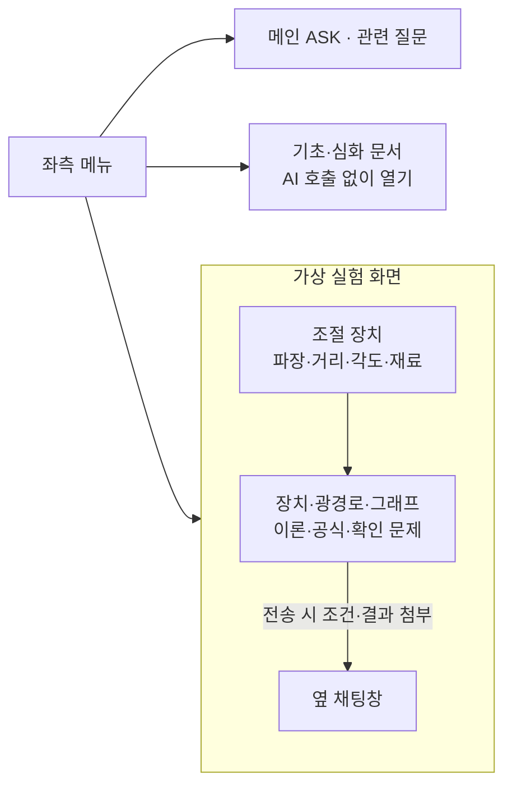
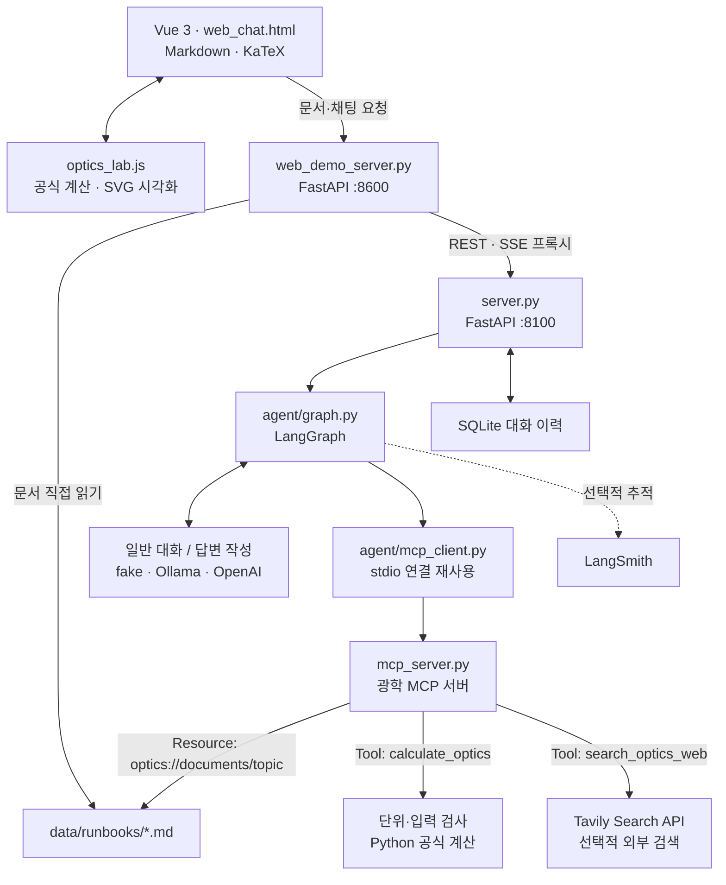
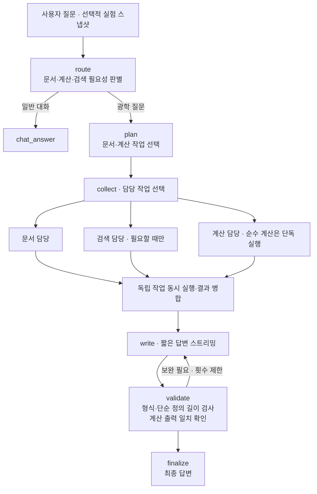

# Optics Lab Assistant

**가상 광학 실험의 조건을 조절하고, 이론·계산·관찰 결과를 질문하는 학습 도우미입니다.**

브라우저 시뮬레이션과 AI 설명을 연결합니다. AI는 관련 로컬 문서를 읽고, 필요한 경우 MCP 공식 계산과 Tavily 검색을 사용합니다. 실제 장비·센서와 연결하지 않습니다.

## 기획 배경

처음에는 반도체 장비의 이상치를 확인한 뒤 관련 대응 매뉴얼을 안내하는 프로그램을 구상했습니다. 하지만 실제 장비 데이터와 대응 절차에는 기밀·접근 제한이 있어, 공개된 원리를 활용할 수 있는 광학 실험·장비 학습으로 범위를 바꿨습니다.

광학 질문도 실험 조건을 직접 만들고 매번 입력해야 한다면 학습 흐름이 끊깁니다. 그래서 **가상 실험을 직접 조절하고, 그 순간의 조건을 공유한 AI에게 바로 질문하는 복습 도구**로 구체화했습니다.

## 대상과 목표

대상은 **실험 수업 중 막힌 학생과 광학 이론을 복습하는 사람**입니다. 현상을 관찰하고, 조건을 바꾸고, 이유를 질문하는 과정을 한 화면에서 이어가는 것이 목표입니다.

| 기존 학습의 불편 | 서비스에서 해결하려는 방식 |
| --- | --- |
| 설정값을 바꾼 뒤 결과를 머릿속으로만 예상해야 함 | 조절에 따른 광경로·무늬·계산 결과를 즉시 표시 |
| 질문할 때 장비와 수치를 매번 다시 설명해야 함 | 전송 시점의 실험 종류·조건·결과를 자동 첨부 |
| 정의를 알아도 현재 실험값과 연결하기 어려움 | 개념의 정의와 현재 설정값·계산값의 의미를 함께 설명 |
| 설명의 근거를 확인하기 어려움 | 로컬 학습 자료·공식 계산·필요한 외부 출처를 연결 |

## 일반 채팅과의 차이

핵심은 **직접 조절하는 실험과 현재 조건을 이해하는 대화의 연결**입니다. 사용자는 실험을 보면서 질문하고, AI는 사용자가 이미 화면에서 선택한 조건을 참고합니다. 단순히 광학 질문에 답하는 것에서 나아가 관찰과 설명을 연결하고자 합니다.

또한 출처를 확인할 수 있는 설명과 재현 가능한 공식 계산을 지향합니다. 다만 **검색 결과가 자동으로 검증되는 것은 아닙니다.** 현재 구현은 참고 문서·검색 URL을 제공하고 지원 수식의 입력·단위·수치 결과를 검사합니다. 모든 자료와 자연어 설명의 사실성을 보장하려면 별도의 검증이 필요합니다.

## 사용할 수 있는 기능

| 영역 | 기능 |
| --- | --- |
| 파동 광학 | 편광판, 마이켈슨 간섭계, 단일슬릿 회절 |
| 반사·굴절 | s/p 입사·반사·투과파, 전반사, 프리즘 분산 |
| 상 형성 | 볼록·오목렌즈, 오목·볼록거울 |
| 결정·전자 | XRD 이론 반사 위치, 광흡수·광전효과·에너지 준위 |
| 광학장비 | 카메라, 케플러·갈릴레이 망원경, 유한·무한 보정 현미경 |
| 학습·질문 | 접이식 이론·공식·확인 문제, 문서 페이지, 실험 조건을 참고하는 채팅 |

## 화면과 사용자 흐름



실험은 페이지 스크롤로 보고 조절 장치는 바로 옆에 둡니다. 실험 화면에서는 오른쪽 분류 목록을 숨깁니다. 문서·실험·메인 사이를 이동해도 대화·입력·설정은 새로고침 전까지 유지됩니다. ‘조건·결과를 채팅에 넣기’는 입력창만 채우며 자동 전송하지 않습니다.

## 각 파트의 역할

아래는 현재 구현의 동작과 기술적 역할입니다. 프로젝트를 시작한 개인적인 동기와는 구분합니다.

### 1. 화면과 실험 조작 — Vue · SVG

`web_chat.html`은 메뉴, 실험 화면, 조절 장치, 문서, 채팅을 한 화면에서 연결합니다. Vue는 슬라이더 값이 달라졌을 때 해당 결과를 다시 표시하고 화면을 이동하는 동안 입력 상태를 유지합니다.

`optics_lab.js`는 광학 공식을 계산하고 장치·광선·간섭무늬를 SVG로 만듭니다. **사용자가 조작한 값에 즉시 반응해야 하는 부분**을 브라우저에서 처리하므로 슬라이더를 움직일 때 서버나 AI 응답을 기다리지 않습니다. 그림은 실제 실험의 모든 물리 현상을 재현하는 정밀 해석기가 아니라 명시된 가정 안의 학습 모델입니다.

### 2. 실험과 질문의 연결 — 전송 시점 스냅샷

질문을 보낼 때 실험 종류·현재 설정·계산 결과를 문자열로 복사해 함께 전달합니다. 사용자가 모든 수치를 다시 입력할 필요 없이 “이 값은 무슨 뜻이야?”처럼 질문할 수 있게 하는 연결입니다. 전송 후 슬라이더를 바꿔도 이전 질문의 조건은 바뀌지 않습니다.

이 정보는 **가상 실험 조건**입니다. 실제 센서로 관측한 값으로 설명하면 안 됩니다. 용어 질문에는 일반 정의를 먼저 말하고 현재 실험에 해당 값이 있으면 그 값·단위·의미를 덧붙이도록 지시합니다.

### 3. 화면 서버와 AI 서버 — FastAPI

`web_demo_server.py`는 화면·JavaScript·문서를 제공하고 채팅 요청을 중계합니다. 브라우저가 같은 출처의 주소로 화면과 채팅을 사용할 수 있게 합니다.

`server.py`는 AI 요청을 실행하고 대화 이력을 저장합니다. 시작할 때 모델·MCP 연결·그래프를 만들고 요청마다 재사용합니다. **화면 제공과 AI 실행의 책임을 분리한 구조**이며 두 프로세스가 필요하다는 운영 부담도 있습니다.

### 4. 작업 흐름 — LangGraph

`agent/graph.py`는 질문 분류부터 답변 검수까지의 실행 순서와 상태를 관리합니다. 문서, 도구 결과, 작성 시도, 오류 상태를 노드 사이에 전달합니다.

현재 분류·계획은 규칙 기반입니다. LLM이 모든 도구를 자유롭게 선택하는 구조가 아니라, **지원 범위 안에서 필요한 경로를 선택하는 도구 사용 에이전트**입니다. 단계가 나뉘어 있어 잘못된 문서 선택과 답변 작성 실패를 구별하기 쉽습니다. 노드 수 자체가 지능이나 정확도를 보장하지는 않습니다.

### 5. 학습 지식 — Markdown · 용어 색인

`data/runbooks/`에는 실험 원리·공식·적용 조건·점검 자료를 저장합니다. `agent/optics.py`와 `data/optics_terms.json`은 질문의 용어와 연결할 문서를 관리합니다. 브라우저가 문서를 직접 열 수도 있고 에이전트가 MCP로 같은 자료를 읽을 수도 있습니다.

**기준 자료를 코드 밖에서 읽고 고칠 수 있는 구조**입니다. 문서를 프롬프트에 참고시키는 것이며 모델을 재학습시키는 것은 아닙니다. 현재는 키워드 매핑으로 조회하므로 새로운 용어·표현에 대한 누락 가능성이 있습니다.

### 6. 외부 기능의 호출 경계 — MCP

`agent/mcp_client.py`는 별도 프로세스의 `mcp_server.py`에 연결합니다. 서버는 문서를 **Resource**, 실행할 계산과 검색을 **Tool**로 제공합니다.

MCP는 모델이나 검색 엔진이 아니라 **에이전트와 기능을 연결하는 호출 규약**입니다. 계산·검색 코드를 답변 생성 코드와 분리하고 같은 인터페이스로 호출합니다. 도구를 연결했다는 사실만으로 모델이 결과를 올바르게 해석한다는 보장은 없습니다.

### 7. 숫자의 근거 — Python 공식 계산

`agent/optics_calculations.py`는 지원되는 질문에서 입력값·단위를 추출하고 식을 계산합니다. 누락값, 단위 불일치, 불가능한 조건을 검사합니다. 결과는 도구의 숫자를 바탕으로 출력해 LLM이 계산값을 다시 만들어 쓰지 않도록 합니다.

브라우저 계산은 **실험 조작에 대한 즉각적인 피드백**, MCP 계산은 **채팅 요청에 대한 입력·단위 확인과 수치 결과 제공**을 담당합니다. 두 구현의 지원 수식 범위는 완전히 같지 않습니다.

### 8. 로컬 자료의 보완 — Tavily

`agent/web_search.py`는 검색이 필요한 것으로 판정된 질문을 Tavily API에 전달합니다. 반환된 제목·URL·발췌를 답변 작성에 참고시키며 실험 스냅샷은 외부 검색에 보내지 않습니다.

로컬 문서에 없는 자료를 찾는 통로이며, 검색 결과가 곧 검증된 정답은 아닙니다. **출처를 확인할 수 있는 설명**을 목표로 하고, 키 미설정·오류·빈 결과는 별도로 처리합니다. 검색 여부 판정도 현재는 규칙 기반입니다.

### 9. 설명과 검수 — LLM · 공통 출력 정책

Ollama와 OpenAI는 문서·실험 조건·검색 결과를 읽고 자연어 설명을 작성합니다. fake 모드는 이 역할을 대신하는 실제 지능 모델이 아니라 연결 테스트용 문서 발췌입니다.

공통 출력 정책은 **결론 우선, 질문 범위 유지, 기본적으로 짧은 답변**을 요구합니다. 검수는 길이·제목·중첩 목록 등의 출력 형식을 검사하고 필요하면 재작성을 요청합니다. 과학적 사실 전체를 검증하는 기능은 아니며, 실제 모델 답변에 대한 별도 평가가 필요합니다.

### 10. 대화·진행 표시·평가 — SQLite · SSE · 테스트

SQLite는 대화 이력을 저장합니다. SSE는 서버의 처리 단계와 답변을 브라우저로 전달합니다. OpenAI와 Ollama 모두 생성 조각을 중계하며, 최종 검수 결과로 같은 말풍선을 갱신합니다. 스트리밍은 첫 표시 대기를 줄이는 것이며 모델의 전체 추론 시간을 없애는 기능은 아닙니다.

`tests/`는 수식·단위·문서 연결·MCP·REST/SSE·검색 오류를 검증합니다. `eval/`은 고정된 계산 문제의 실제 도구 결과를 비교합니다. 선택적인 LangSmith는 실행 경로와 모델 호출을 추적하는 관측 도구입니다. **테스트 통과·추적 기록과 실제 학습 효과는 별도로 평가**해야 합니다.


## 시스템 아키텍처



**슬라이더 계산과 AI의 MCP 계산은 별도 경로입니다.** 슬라이더 조작에는 LLM을 호출하지 않습니다. 채팅의 지원 계산은 MCP 서버에서 다시 계산하고 입력·단위·공식·결과를 반환합니다.

문서 조회는 키워드와 제한된 대화 맥락으로 문서 ID를 선택하는 방식이며 벡터 검색은 아닙니다. `data/optics_terms.json`에 실험 전반의 핵심 용어 56묶음과 동의어를 관리하고, 해당 정의를 실험 문서에 수록합니다. 용어 질문에는 정의와 함께 해당 실험의 설정값·계산값을 구분해 설명하도록 지시합니다. 없는 값은 추정하지 않습니다. 용어의 띄어쓰기·영문 대소문자를 정규화해 조회하며 전체 어휘의 문서 연결을 테스트합니다. 실험 첨부 정보가 현재 질문의 주제를 덮어쓰지 않도록 구분합니다.

## 에이전트 처리 흐름



분류·계획은 규칙으로 수행하며 불필요한 LLM 호출을 추가하지 않습니다. collect 노드가 필요한 담당 작업을 골라 실행합니다. 문서 조회와 검색은 서로 독립적이면 동시에 실행합니다. 지원되는 순수 계산 질문은 문서·검색·LLM 작성 없이 계산 도구와 결정적인 출력만 사용합니다. 검색하지 않거나 계산하지 않는 질문에서는 해당 도구 호출을 생략합니다. 모든 단계를 여러 LLM이 각각 담당하는 구조는 아닙니다.

검수는 일반 답변의 모든 물리적 사실을 확인하는 검증기가 아닙니다. 계산은 도구 결과와 출력이 일치하는지 확인하고, 일반 질문은 공통 길이·제목·중첩 목록 규칙으로 검사하고 재작성합니다. 질문별 고정 정답은 사용하지 않습니다. 일반·상세 답변 모두 생성 조각을 중계합니다. 단순 제목·목록 서식은 코드로 정리하고 길이·불완전 응답에 대해서만 최대 한 번 재작성합니다. 최종 답변이 정본이며 생성 중인 초안은 교체될 수 있습니다.

### MCP 계산 범위

| 계산 | 입력 |
| --- | --- |
| 광자 에너지 | 파장 |
| 브래그 각 | X선 파장·면간격·차수 |
| 마이켈슨 파장 역산 | 거울 변위·간섭 주기 수 |
| 마이켈슨 간섭 주기 수 | 거울 변위·파장 |
| 말뤼스 법칙 | 입사 세기·상대각 |
| 얇은 렌즈 | 초점거리·물체 거리 |

단위·유한 숫자·입력 범위·식의 성립 조건을 검사합니다. 계산 답변은 LLM이 숫자를 재생성하지 않고 도구 결과로 작성합니다. [계산 설계와 평가](optics-agent-calculation.md)를 참고하세요.

### Tavily 검색

`.env`의 `TAVILY_API_KEY`를 설정하면 검색 도구를 사용할 수 있습니다. ‘검색·출처·논문·문헌’ 요청과 일부 물질·특수 조건 표현을 규칙으로 판별합니다. 모든 지식 부족을 자동 감지하지는 않습니다. 검색이 필요하면 질문에 **‘출처 검색해줘’**를 붙일 수 있습니다.

질문 본문만 전송하고 실험 스냅샷은 보내지 않습니다. 허용 도메인으로 제한해 최대 6건을 요청하고, 반환 URL을 다시 검사해 최대 3건의 제목·URL·발췌를 작성 모델에 전달합니다. 키 미설정·인증 오류·실패·빈 결과를 구분하며 API 오류 본문과 키를 답변에 포함하지 않습니다. 결과는 검증된 데이터베이스 값과 같지 않으며, 실제 자료를 확인할 필요가 있습니다.

### 검색 출처 제한

이전 LangChain·AI Agent 과제 노트북의 **허용 도메인 목록과 호스트 검사**를 광학 서비스에 적용했습니다. [도메인 목록](../data/search_domains.json)에는 정부 연구기관, 공개 교재, 대학 강의, 광학·물리 학회, 학술 출판사와 논문 저장소를 지정합니다. 의학 중심의 출처 목록은 그대로 가져오지 않았습니다.

1. Tavily 요청에 `include_domains`와 `include_domains_mode=restrict`를 설정합니다.
2. 결과 URL의 실제 호스트가 목록과 일치하거나 그 하위 도메인인지 다시 확인합니다. 허용 이름이 경로나 다른 호스트에 들어 있기만 한 URL은 통과시키지 않습니다.
3. 허용 결과가 없으면 미확보 상태를 반환합니다. 제한을 자동 해제해 임의 출처로 재검색하지 않습니다.

도메인 제한은 **출처 범위를 관리하는 규칙**이며 내용의 정확성·최신성·동료심사를 보장하지 않습니다. 목록 밖의 유용한 자료를 놓칠 수 있고, 논문 저장소 자료는 게재·심사 상태를 별도로 확인해야 합니다. 도메인 변경은 목록 파일 수정 후 백엔드를 재시작합니다.

API 설정은 [Tavily Search 공식 문서](https://docs.tavily.com/documentation/api-reference/endpoint/search)를 따릅니다.

## 실행 방법

프로젝트 루트에서 환경을 준비합니다.

```bash
bash sh/setup_venv.sh
# .env가 없을 때만 복사
cp .env.example .env
```

기존 `.env`는 덮어쓰지 않습니다. OpenAI 사용 시 `OPENAI_API_KEY`, 검색 사용 시 `TAVILY_API_KEY`를 입력합니다. 키는 저장소에 올리지 않습니다.

터미널 1에서 백엔드 하나를 선택합니다.

```bash
# OpenAI: API 사용료 발생, 키 필요
bash sh/run_agent_openai.sh
```

```bash
# Ollama: 최초 모델 준비 후 실행
bash sh/setup_ollama.sh
bash sh/run_agent_ollma.sh
```

LLM 없이 연결을 확인하려면 `.env`의 `LLM_BACKEND=fake`를 설정합니다.

```bash
.venv/bin/python -m uvicorn server:app --host 127.0.0.1 --port 8100
```

터미널 2에서 화면을 실행합니다.

```bash
bash sh/run_frontend.sh
```

**http://localhost:8600** 접속. 백엔드는 **8100**, 화면 서버는 **8600**입니다. 설정·백엔드 코드를 바꾸면 백엔드를 재시작합니다. Vue CDN 방식으로 npm 빌드가 없으며 CDN 로딩에는 인터넷 연결이 필요합니다. LangSmith는 선택 사항입니다.

## 주요 파일

```text
├── web_chat.html                 # 실험·조절·문서·채팅 화면
├── optics_lab.js                 # 공식·장치/광선·결과 SVG
├── web_demo_server.py            # 화면·문서 제공, 채팅 프록시
├── server.py                     # 모델·MCP·세션 초기화, REST/SSE
├── mcp_server.py                 # 광학 문서·계산·검색 MCP
├── agent/
│   ├── graph.py                  # 질문 분류부터 최종 답변까지
│   ├── optics.py                 # 문서 매핑·공통 답변 정책
│   ├── optics_calculations.py    # 입력 해석·단위·공식·결과 형식
│   ├── web_search.py             # Tavily 요청·결과·오류 처리
│   ├── mcp_client.py             # stdio MCP 연결·호출
│   ├── fake_llm.py               # 연결 검증용 결정적 응답
│   ├── openai_llm.py             # OpenAI 대화·답변 작성
│   ├── ollama_llm.py             # Ollama 대화·답변 작성
│   └── session_store.py          # SQLite 대화 저장
├── data/runbooks/                # 광학·측정·모델 학습 자료
├── tests/                       # 수식·장치·문서·MCP·검색 검증
├── eval/                        # 계산 고정 평가 쿼리·결과
├── sh/                          # 환경 준비·실행·배포 묶음
└── doc/                         # 사용 가이드·설계·회귀 테스트
```

## 검증과 한계

```bash
node tests/test_simulations.cjs
node tests/test_equipment.cjs
LANGCHAIN_TRACING_V2=false .venv/bin/python -m unittest discover -s tests -v
LANGCHAIN_TRACING_V2=false .venv/bin/python eval/optics_calculation_eval.py
```

Python 통합 검증은 fake LLM과 실제 MCP 프로세스를 사용합니다. Tavily API 규격·오류 테스트는 모의 HTTP 요청으로 수행합니다. 실제 모델의 설명 품질과 실제 API 연결은 별도로 확인해야 합니다.

- XRD는 격자상수·소멸 규칙에 따른 이론 위치를 표시하며 실제 강도·배향을 예측하지 않습니다.
- 광흡수·광전효과는 에너지 문턱 모형이며 실제 전류·흡수율·전자 수명을 계산하지 않습니다.
- s/p 모델은 비흡수 유전체를 가정하며 전반사 위상차·소멸파는 생략합니다.
- 장비 그림은 학습용 이상화 모델입니다. 실제 정비·공정 설정 지침을 대신하지 않습니다.

[OpenAI 가이드](manual_openai.md) · [Ollama 가이드](manual_ollma.md) · [회귀 테스트](regression_test_queries.md) · [학습 문서 목록](../data/runbooks/README.md)


## 응답 대기와 호출 수 관리

- **담당 분리:** 문서·검색·계산을 수행하는 함수형 작업자를 collect 노드가 조율합니다. 각 작업자마다 LLM을 추가 호출하지 않습니다.
- **병렬 실행:** 문서·검색 요청을 함께 시작하고 MCP의 전역 호출 잠금으로 서로 기다리지 않도록 합니다. 도구 목록 발견 결과만 연결 수명 동안 재사용하며 문서 내용은 매번 읽습니다.
- **순수 계산 경로:** 지원 수식은 문서 조회와 LLM 작성을 건너뜁니다. 계산에 검색값을 자동 연결하는 의존 작업 흐름이나 복합 검색·계산 요청은 별도 확장 대상입니다.
- **작성량 제한:** 기본 질문에는 관련 문단을 발췌해 문서 전체 입력을 줄이고 생성 토큰 예산을 둡니다. 자세한 요청에는 더 큰 예산을 사용합니다.
- **재작성 제한:** 서식은 로컬 정리하며 내용 길이·불완전 출력 검사에서만 한 번 재시도합니다. 검사에 실패한 답변을 무조건 통과시키지는 않습니다.
- **시간 기록:** REST `metadata.timings`에 자료·검색·계산·작성 및 작성 시작 후 첫 조각까지의 시간을 기록합니다. `first_token`은 요청 전체 대기 시간이 아닌 작성 단계 기준입니다. SSE는 자료 준비·작성 이벤트에 소요 시간을 포함합니다.

`tests/test_latency.py`는 병렬 요청의 겹침, 생략해야 할 호출, 서식으로 인한 재생성 방지, OpenAI 스트리밍 중간 전달을 모의 도구·HTTP로 검사합니다. 실제 OpenAI/Ollama/Tavily의 지연 감소율을 측정한 결과는 아닙니다.

OpenAI 스트리밍 구현은 [공식 OpenAI 문서](https://developers.openai.com/api/reference/resources/chat/subresources/completions/streaming-events)를 따릅니다.
