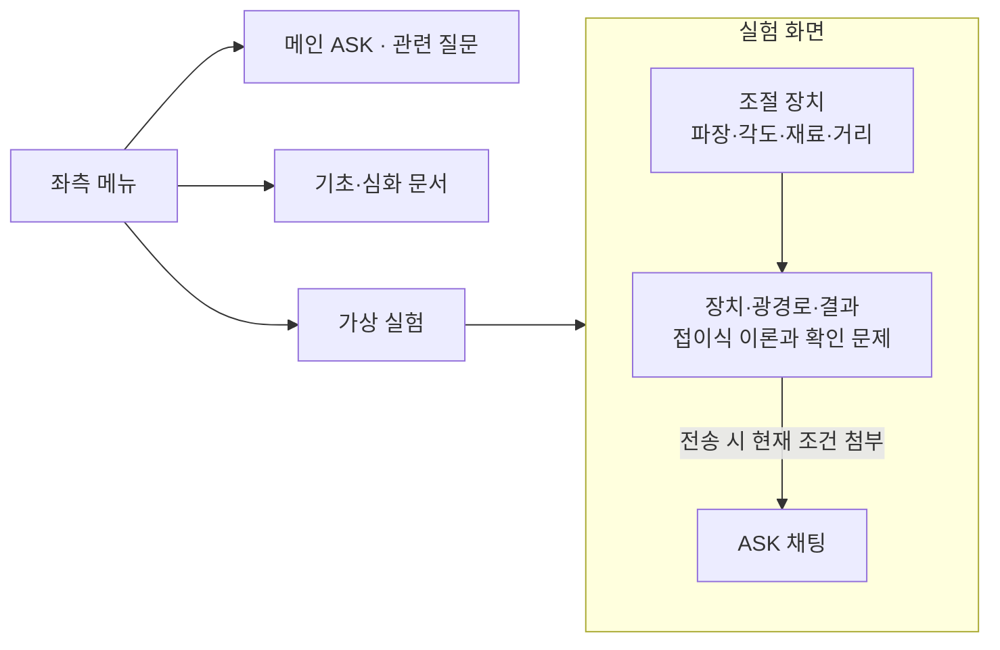
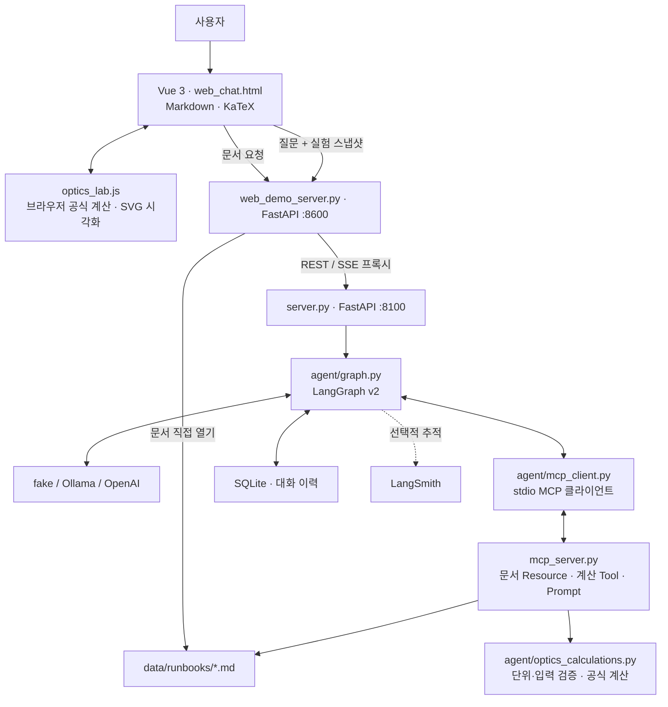
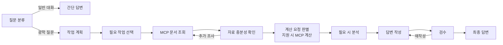

# Optics Lab Assistant

**대화형 광학 실험·장비 이상 점검 도우미**

가상 실험의 조건을 직접 바꾸고, 관찰한 현상과 계산 결과를 AI에게 질문하는 광학 학습 서비스입니다. 이론·공식·적용 조건과 실험별 확인 문제를 함께 제공합니다.

## 주요 기능

- **가상 실험:** 편광판, 렌즈·거울, 마이켈슨 간섭계, XRD, s/p 반사·전반사, 프리즘 분산, 단일슬릿 회절, 광흡수·광전효과.
- **광학장비 모형:** 카메라, 케플러식·갈릴레이식 망원경, 유한 경통·무한 보정 현미경.
- **실험과 대화 연결:** 실험 화면에서 질문을 전송하면 그 순간의 실험 조건·결과를 함께 전달합니다. 결과 넣기 버튼은 입력창을 채우며 전송은 사용자가 합니다.
- **문서 기반 설명:** 질문과 이전 대화를 바탕으로 관련 광학 Markdown 문서를 조회해 원리·공식 또는 점검 순서를 안내합니다.
- **MCP 수치 계산:** 지원되는 계산은 Python 도구로 수행하고 입력값·단위·공식·결과·조건을 표시합니다.
- **학습 화면:** 실험 옆에 조절 장치와 채팅을 배치합니다. 이론·공식과 유의사항·확인 문제는 접었다 펼칩니다. 화면을 이동해도 대화와 설정은 새로고침 전까지 유지됩니다.
- **답변 표시:** Markdown·LaTeX 수식, 처리 단계 SSE 스트리밍, 답변 중지 기능을 제공합니다.

## 화면 구성



메인 오른쪽 목록은 관련 질문 분류를 열고, 좌측 학습 문서는 AI 호출 없이 문서 페이지를 엽니다. 실험 화면에서는 오른쪽 실험 목록을 숨깁니다.

## 아키텍처



**브라우저 시뮬레이션과 에이전트의 MCP 계산은 별도 경로입니다.** 슬라이더 조작은 브라우저에서 계산하며 LLM을 호출하지 않습니다. 질문 전송 후 지원되는 계산 요청을 판별하면 에이전트가 실제 MCP 도구를 호출합니다.

문서 조회는 키워드·대화 맥락을 이용한 문서 ID 매핑입니다. 벡터 DB 검색이나 실시간 웹 검색은 구현하지 않았습니다. MCP의 `runbook://incident-response/{문서 ID}` URI와 일부 내부 이름은 초기 기반 코드의 명칭을 유지하지만, 광학 경로에서는 광학 문서를 조회합니다. `mcp_server_docs.py`는 다중 서버 탐색 확인용 보조 서버입니다.

## AI 처리 흐름



계산 결과는 결정적인 형식으로 출력해 LLM이 숫자를 다시 생성하지 않도록 합니다. 검수는 구현된 형식·필수 항목 규칙을 확인하며, 모든 물리적 사실의 정확성을 보장하는 검증기는 아닙니다.

### MCP 계산 범위

| 계산 | 대표 입력 |
| --- | --- |
| 광자 에너지 | 파장 |
| 브래그 각 | X선 파장·면간격·차수 |
| 마이켈슨 파장 역산 | 거울 변위·간섭 주기 수 |
| 마이켈슨 주기 수 | 거울 변위·파장 |
| 말뤼스 법칙 | 입사 세기·편광판 상대각 |
| 얇은 렌즈 | 초점거리·물체 거리 |

입력 단위와 유효 범위를 검사합니다. 지원하지 않는 계산·누락된 값은 임의로 채우지 않습니다. 상세 설계와 평가 방법은 [광학 계산 에이전트 문서](optics-agent-calculation.md)를 참고하세요.

## 실행 방법

프로젝트 루트 폴더에서 실행합니다.

```bash
bash sh/setup_venv.sh
cp .env.example .env
```

이미 `.env`가 있으면 복사하지 않고 필요한 항목만 수정합니다. 광학 에이전트는 `SUPERVISOR_VERSION=v2`를 사용합니다. 실제 키는 `.env`에만 넣고 저장소에 올리지 않습니다.

**터미널 1 — 백엔드:** 아래 중 하나를 선택합니다.

```bash
# OpenAI: .env의 OPENAI_API_KEY 필요, API 사용료 발생
bash sh/run_agent_openai.sh
```

```bash
# Ollama: 최초 모델 준비 후 로컬 실행
bash sh/setup_ollama.sh
bash sh/run_agent_ollma.sh
```

LLM 없이 연결을 확인하려면 `.env`에서 `LLM_BACKEND=fake`를 설정하고 다음을 실행합니다.

```bash
.venv/bin/python -m uvicorn server:app --host 127.0.0.1 --port 8100
```

**터미널 2 — 프론트엔드:**

```bash
bash sh/run_frontend.sh
```

브라우저에서 **http://localhost:8600**에 접속합니다. 백엔드는 **8100**, 화면 서버는 **8600**을 사용합니다. 백엔드가 응답하지 않는다는 메시지는 먼저 8100 서버의 실행 상태를 확인하면 됩니다.

프론트엔드는 Vue CDN 방식으로 별도 npm 빌드가 없습니다. CDN 스크립트 로딩에는 인터넷 연결이 필요합니다. fake 모드는 연결 확인용이므로 자연스러운 후속 설명에는 Ollama 또는 OpenAI를 사용하세요. LangSmith 추적은 선택 사항이며 관련 키와 설정이 필요합니다.

## 사용 예시

- “산란이 뭐야?” — 질문한 개념을 설명합니다.
- “마이켈슨 간섭계에서 무늬가 안 보여요.” — 관련 문서를 바탕으로 확인할 조건을 안내합니다.
- “532 nm 광자의 에너지를 계산해줘.” — MCP 계산 결과와 단위를 표시합니다.
- XRD 실험에서 재료·각도를 바꾼 뒤 “현재 조건에서 브래그 피크가 어디에 생겨?”라고 질문합니다.

## 주요 파일

```text
├── web_chat.html                  # 메뉴·실험·문서·채팅 UI
├── optics_lab.js                  # 광학 공식·장치/광선 SVG·가상 실험
├── web_demo_server.py             # 화면·문서 제공, API/SSE 프록시
├── server.py                      # 에이전트 API
├── mcp_server.py                  # 광학 문서·계산 MCP 서버
├── mcp_server_docs.py             # 다중 MCP 탐색 보조 서버
├── agent/
│   ├── graph.py                   # LangGraph 처리 흐름
│   ├── optics.py                  # 광학 질문·문서 매핑
│   ├── optics_calculations.py     # 계산 판별·단위 검증·공식·결과 형식
│   ├── mcp_client.py              # MCP 연결·리소스/도구 호출
│   ├── fake_llm.py                # 연결 확인용 응답
│   ├── ollama_llm.py              # 로컬 모델
│   ├── openai_llm.py              # OpenAI 모델
│   └── session_store.py           # SQLite 대화 저장
├── data/runbooks/                 # 광학 학습·점검 문서
├── tests/                        # 시뮬레이션·에이전트·계산 검증
├── eval/                         # 계산 평가 쿼리·결과
├── sh/                           # 환경 준비·실행 스크립트
└── doc/                          # 실행 가이드·설계 문서
```

## 검증

```bash
node tests/test_simulations.cjs
node tests/test_equipment.cjs
LANGCHAIN_TRACING_V2=false .venv/bin/python -m unittest discover -s tests -v
```

가상 실험은 이상화한 학습 모델입니다. XRD 재료 프리셋은 이론적 피크 위치를 제공하며 실제 회절 세기를 예측하지 않습니다. 광흡수·광전효과는 문턱 에너지와 내부 들뜸·외부 방출을 구분하는 모형으로, 실제 흡수율·전류를 계산하지 않습니다. 실제 장비·센서에 연결하거나 실측 데이터를 생성하지 않습니다.

## 관련 문서

- [OpenAI 실행 가이드](manual_openai.md)
- [Ollama 실행 가이드](manual_ollma.md)
- [광학 계산 에이전트 설계·평가](optics-agent-calculation.md)
- [광학 학습 문서 목록](../data/runbooks/README.md)
- [노광 · 정밀장비 핵심 정리](../data/runbooks/lithography-process.md)
